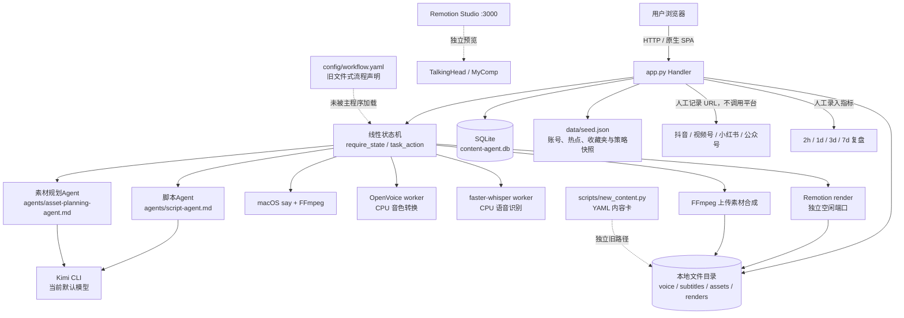
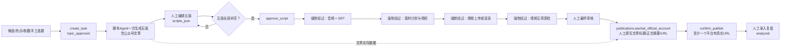
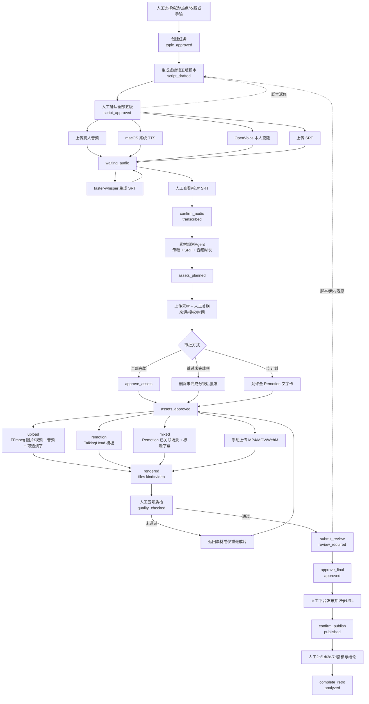

# 现有 AI 内容营销系统深度审计

> 审计对象：`http://127.0.0.1:8765/` 对应的本机项目  
> 项目根目录：`/Volumes/EXTERNAL_USB/kimi/content-agent`  
> 审计方式：只读代码审查、只读 SQLite 查询、GET 接口与页面检查、现有日志和产物检查、静态语法检查。未调用任何会创建任务、生成媒体、写设置或改变工作流状态的 POST/PUT 接口；未安装工具、未改配置、未执行数据库迁移。

## 0. 结论摘要

1. **系统是一套本地单页内容工作台，不是通用 DAG/Agent 工作流平台。** 后端为 Python 标准库 `ThreadingHTTPServer` + SQLite，前端为原生 HTML/CSS/JavaScript，视频模板为独立 Remotion/React/TypeScript 子项目。真实流程由 `app.py` 中的函数和状态条件驱动。
2. **文章与视频没有独立工作流。** 母稿、抖音、视频号、小红书口播和公众号文章在同一个脚本节点生成，并共用一个 `tasks.state`。文章必须跟随视频经过录音、字幕、素材、渲染等节点，无法独立进入审核发布。
3. **AI 局部能力已有真实运行记录。** 当前正式任务有 Kimi 五版脚本、系统 TTS、OpenVoice 克隆音频、faster-whisper SRT、素材规划和人工素材审批记录。Remotion 自测接口最近返回 200。
4. **正式端到端生产尚未跑通。** 只读数据库中有 4 个任务：3 个停在 `topic_approved`，1 个停在 `assets_approved`；`files` 中正式视频记录为 0，所有任务均未发布、未复盘。不能把“Agent 已连接”理解为“整条内容生产与发布链已验收”。
5. **自动平台能力并未接入。** 账号页、热榜和收藏夹来自静态快照；发布是人工填写状态和 URL；数据复盘是人工录入。项目内没有自动登录、平台发布、自动采集或定时调度实现。
6. **优先需要修正的是内容类型解耦、音频字幕版本绑定、长任务持久化和两套流程定义不一致，而不是先增加更多 Agent 名称。**

### 证据标记

- **代码事实**：可由指定文件、函数或接口直接确认。
- **运行证据**：来自本次只读页面/接口/进程/数据库检查或已有日志。
- **审计判断**：基于代码事实作出的架构评价或改造建议。
- **未验证**：受只读约束，本次没有重新执行会写文件或改状态的生成、渲染、发布操作。

---

## 1. 系统真实架构

### 1.1 技术栈、启动方式与模块

| 项目 | 真实现状 | 证据 |
|---|---|---|
| 主后端 | Python 3 标准库；`BaseHTTPRequestHandler`、`ThreadingHTTPServer`、`sqlite3`，无 FastAPI/Flask/Django | `app.py:1-17`、`app.py:1718-2023` |
| 主前端 | 单页原生 JavaScript，无 React/Vue、无前端构建步骤 | `web/index.html:11-35`、`web/app.js:1-494` |
| 数据库 | SQLite；8 张业务表，任务主体字段大量采用 JSON 文本 | `app.py:115-193` |
| 主服务启动 | `/usr/bin/python3 app.py --port 8765`；只监听 `127.0.0.1` | `app.py:2008-2023` |
| 双击启动器 | `ContentWorkflow.app`；写 PID 和 `data/server.log`，轮询 `/api/bootstrap` | `ContentWorkflow.app/Contents/MacOS/launcher:1-42` |
| Remotion | Remotion 4.0.538、React 19.2.3、TypeScript 5.9.3；Node 22 满足 engines | `remotion-app/package.json:7-31` |
| Studio 启动 | `npx remotion studio --no-open --port=3000`，主入口 `TalkingHead` | `remotion-app/src/Root.tsx:38-54`、`remotion-app/src/index.ts:1-4` |
| 后台渲染 | `npx remotion render src/index.ts TalkingHead ... --codec=h264 --port=<空闲端口>` | `app.py:1543-1558` |
| 语音 | macOS `say` + FFmpeg；OpenVoice V2 + MeloTTS/Torch CPU | `app.py:1180-1195`、`workers/openvoice_worker.py:34-68` |
| 字幕 | 名为 WhisperX 的入口，实际工作进程使用 `faster_whisper.WhisperModel` | `app.py:1112-1122`、`workers/whisperx_worker.py:6,26-52` |
| 上传合成 | FFmpeg；Pillow 生成透明中文字幕 PNG 后 overlay | `app.py:1561-1603`、`workers/caption_images.py:38-64` |
| 旧文件式工具 | `scripts/new_content.py` 创建 YAML 内容卡和目录，与网站 SQLite 流程分离 | `scripts/new_content.py:9-114` |

**运行证据：** 本机为 Python 3.9.6、Node 22.22.0、npm 10.9.4、FFmpeg 9.0.2；主服务 PID 对应 `app.py --port 8765`，首页、`/api/bootstrap`、任务 GET、音频/SRT 媒体 GET 和 Studio 均返回 HTTP 200。`npm run lint`（ESLint + `tsc`）通过；主 Python/worker 文件 AST 解析和 `web/app.js` 语法检查通过。

**代码事实：** 主项目没有依赖清单或自动化测试配置；Remotion 子项目有 `package.json`、锁文件和 lint。报告中的“通过”不表示主流程已有自动化回归测试。

### 1.2 真实架构图

### 1.3 数据存储与数据传递

| 数据 | 实际载体 | 传递方式与位置 |
|---|---|---|
| 选题 | `topics`、`hotspot_snapshots`、`tasks.source_json` | 手工/快照创建任务；`create_task()`，`app.py:534-605` |
| 五版文本 | `tasks.scripts_json` | 一个 JSON 对象同时保存母稿、三个视频版本和公众号文章；`save_scripts()` |
| 音频、字幕、素材、成片 | `files` 表 + 本地文件 | 文件记录按任务关联；`upload_file()`、`file_dict()` |
| 分镜 | `tasks.asset_plan_json` | 数组内保存时间段、类型、来源、授权、`file_id` 和提示词；`save_assets()` |
| Remotion 输入 | 临时 props JSON + `remotion-app/public/assets/{task}` 副本 | `prepare_render_assets()`、`run_remotion_render()` |
| 质检 | `tasks.quality_json` | 五项布尔值、总通过状态和备注；`save_quality()` |
| 发布 | `tasks.publications_json` | 四平台状态、标题、简介、标签、URL；`save_publications()` |
| 复盘 | `tasks.metrics_json`、`tasks.retrospective` | 四时间点六项指标和人工结论；`save_metrics()` |
| 审批与历史 | `tasks` 时间戳 + `events` | 状态与事件同事务更新；`task_action()`、`add_event()` |
| 能力状态 | `settings` | 最近成功、错误、ready 标记和最近音色；`record_*_result()` |

**审计判断：** 这不是“节点输出按边传递”的引擎，而是每个函数读取并改写整个任务记录及 JSON 字段。优点是直接，缺点是类型隔离、版本关系和节点复用较弱。

### 1.4 全部功能菜单与页面

主站是单页应用，菜单切换 `<section>`，没有独立前端路由。证据：`web/index.html:13-32`、`web/app.js:53-68`。

| 菜单 | 对应页面与真实功能 | 主要代码 |
|---|---|---|
| 今天 | 本周发布数、进行中、待审核、待复盘；展示当前任务下一步 | `renderToday()`，`web/app.js:70-89` |
| 选题 | 抖音收藏夹快照、抖音热榜快照、5 个候选题、手动创建 | `renderTopics()`，`web/app.js:94-105` |
| 任务 | 9 阶段工作台：选题、脚本、录音字幕、素材授权、成片、质检、审核、发布、复盘 | `renderTasks()`、`renderStage()`，`web/app.js:107-249` |
| 账号 | 抖音、小红书、视频号、公众号四平台静态账号/内容快照 | `renderAccounts()`，`web/app.js:254-266` |
| 设置 | Kimi、素材规划、视频构建、系统语音、WhisperX、OpenVoice 状态与真实自测入口 | `renderSettings()`，`web/app.js:268-275` |
| 独立 Studio | Remotion `TalkingHead` 预览；另有空白 `MyComp` 示例，不在主站菜单 | `remotion-app/src/Root.tsx:38-54`、`Composition.tsx:9-25` |

没有独立“文章”“素材库”“发布中心”“任务队列”或“平台登录”页面。

### 1.5 AI 员工、Agent、Skills 与工具调用

| 名称 | 真实实现 | 状态判断 | 证据 |
|---|---|---|---|
| 选题Agent | 没有 Agent 文件或生成接口；候选、热点和收藏夹为人工选择的快照 | **仅有界面/快照** | `web/app.js:94-104`、`app.py:1852-1866` |
| 脚本Agent | Kimi CLI 加载 `agents/script-agent.md`，严格五字段 JSON，人工审批 | **已实现可用，有正式任务记录** | `app.py:309-337,626-684`；`agents/script-agent.md:1-30` |
| 素材规划Agent | Kimi CLI 加载独立 Agent 文件，生成 4–10 个分镜并校验 | **已实现可用，有正式任务记录** | `app.py:712-823`；`agents/asset-planning-agent.md:1-23` |
| 视频构建Agent | 不是 LLM Agent；是 Remotion/FFmpeg 渲染函数集合 | **已接入；自测成功，正式任务未渲染** | `app.py:1470-1691` |
| 质检Agent | 没有自动质检 Agent；五项由人工勾选 | **仅有界面（人工表单可用）** | `app.py:872-886`、`web/app.js:221-227` |
| 发布复盘Agent | 没有发布或复盘 Agent；人工记录发布与结论 | **仅有界面（人工记录可用）** | `app.py:889-954,1044-1061` |
| 数据分析Agent | 账号页为快照，指标手填；无采集或分析调用 | **仅有界面/快照** | `web/app.js:241-265`、`app.py:1852` |
| 系统语音生成 | macOS 音色，保存 WAV，记住最近使用音色 | **已实现可用，有正式音频** | `app.py:377-398,1180-1266` |
| OpenVoice 本人克隆 | 授权样本档案、独立样本目录、CPU 克隆生成 | **已实现可用，有正式音频** | `app.py:1269-1394`、`workers/openvoice_worker.py` |
| WhisperX 自动字幕 | 入口和状态叫 WhisperX；实际转写是 faster-whisper | **已实现可用，但命名与引擎不一致** | `app.py:1112-1177`、`workers/whisperx_worker.py:6,29-36` |

**Skills 事实：** 项目内没有 `SKILL.md` 或独立 Skills 注册/加载机制。两个 `agents/*.md` 是带 frontmatter 的 Kimi Agent 定义，不应称为 Skills。两者均为 `tools: []`、`subagents: []`；后端通过 `kimi --agent-file ... -p ... --output-format stream-json` 调用，见 `app.py:309-321`。没有 MCP、函数工具白名单框架或 Agent 间自动委托。

**外部工具事实：** 工具调用是 Python `subprocess` 直接执行 Kimi CLI、FFmpeg/FFprobe、macOS `say`、Python worker 和 npx；统一超时与输出截断由 `run_process()` 提供（`app.py:196-210`）。Kimi 使用本机 CLI 当前默认模型，不固定模型 ID（`get_ai_status()`，`app.py:258-268`）。

### 1.6 工作流引擎、调度、状态与审批

#### 真正执行的引擎

- `STATES` 定义 14 个状态：`app.py:58-62`。
- `require_state()` 做前置状态检查：`app.py:513-516`。
- `task_action()` 用条件分支执行审批和返修：`app.py:957-1065`。
- 各保存/上传/生成函数也可直接推进状态，并非所有迁移都集中在 `task_action()`。
- 前端另维护 `stateNames`、`stageFor`、`nextNames` 三份映射：`web/app.js:7-13`。
- 正式任务创建直接进入 `topic_approved`，不会经过运行时的 `idea`：`create_task()`，`app.py:584-603`。

#### 调度与并发

- 每个 HTTP 请求同步执行生成、转写或渲染，调用方一直等待；没有后台任务表、队列、进度百分比、取消、断点续跑或重启恢复。
- `ThreadingHTTPServer` 提供请求级并发；SQLite 写操作由进程内 `DB_LOCK` 保护。
- `GENERATING` 只防止脚本和素材规划的同任务重复生成，且只存在内存中；TTS、转写和渲染不受其保护（`app.py:45,655-684,779-806`）。
- 前端 `state.generating/rendering/...` 只在当前标签页有效，刷新后丢失，不是持久任务状态（`web/app.js:3,306-374`）。
- 没有 cron、定时器、WebSocket、SSE 或轮询任务进度接口。

#### 人工审批

| 检查点 | 真实机制 |
|---|---|
| 选题 | 创建任务即视为确认；无独立 `approve_topic` action |
| 脚本 | 五版均非空后 `approve_script` |
| 录音字幕 | 只检查任务中至少有一个音频和一个 SRT，再人工 `confirm_audio` |
| 素材 | 检查名称、来源、关联文件和授权勾选；可人工跳过未完成项 |
| 质检 | 人工五项检查，失败可返修，通过才可提交审核 |
| 最终审核 | `approve_final` 与发布确认分开 |
| 发布 | 至少一个平台为 `published` 且有 http(s) URL，再 `confirm_publish`；不会实际发布 |
| 复盘 | 四时间点的 views 均非空且有结论，再 `complete_retro` |

证据：`app.py:957-1065`。审批记录时间戳和事件，不记录审批人身份；旧 YAML 模板中的 `approved.by` 并未用于网站。

#### 声明式 YAML 不是运行引擎

`config/workflow.yaml:1-155` 虽定义了状态、迁移、所需文件和审批，但主程序没有读取它。其要求与网站实际数据不同：

| YAML 声明 | 网站实际 |
|---|---|
| `narration/{id}/master.md` 等 Markdown | `tasks.scripts_json` |
| `voice/{id}/source.wav` | UUID 命名的多条音频记录 |
| `subtitles/{id}.srt` | `subtitles/{id}/...srt` |
| `assets/{id}/plan.yaml` | `tasks.asset_plan_json` |
| `renders/{id}/quality.yaml` | `tasks.quality_json` |
| 固定平台成片文件名 | `{mode}-{platform}-{uuid}.mp4` |

`templates/content-card.yaml` 与 `scripts/new_content.py` 属于旧文件式路径；现有 `content_cards/20261024-001.yaml` 不在网站 SQLite 任务列表中。这是两套并存模型，不应把 YAML 图当作当前真实节点图。

---

## 2. 系统特色和已有优势

1. **本地化、低框架依赖。** 主程序只依赖 Python 标准库，媒体与业务数据在本机，服务仅监听回环地址；适合个人创作台。证据：`app.py:15-24,2015-2017`。
2. **人工审批边界明确。** 脚本、素材授权、最终审核和发布确认是不同事件；发布链接必填防止把“保存记录”误当“已发布”。证据：`task_action()`、`save_publications()`。
3. **一次任务管理多平台表达。** 五版文本、四平台发布记录和统一复盘已经有数据模型，不必从零设计。证据：`SCRIPT_KEYS`、`PLATFORMS`，`app.py:46-47`。
4. **从脚本到语音、字幕、分镜、画面已具备可复用局部模块。** 正式事件证明 Kimi、TTS、克隆、转写和分镜不只是静态按钮。
5. **本人音色记忆库有授权和最近使用机制。** 样本独立保存，生成时再次校验授权和路径；系统/克隆共用最近使用推荐。证据：`app.py:377-398,1291-1394`、`web/app.js:177-190`。
6. **三种视频构建路径已接入同一任务。** 全 Remotion、全上传 FFmpeg、混合 Remotion，以及手动成片上传共用后续质检与审批。
7. **错误提示比常见原型更可操作。** 后端返回 `error / field / action / item`，前端展示“错误、位置、怎么改”。证据：`app.py:71-108,1734-1744`、`web/app.js:19-46`。
8. **媒体安全与基础完整性校验较完整。** 文件名和任务目录约束、上传非空/扩展名/大小、FFprobe 轨道和时长、成片必须含音频、媒体 Range 请求均已实现。证据：`app.py:1068-1109,1397-1435,1606-1610,1778-1825`。
9. **数据缺失不当作 0。** 账号快照和复盘明确区分未读取与零值，适合后续做可信分析。证据：`config/analytics.yaml:4-13`、`save_metrics()`。

---

## 3. 当前文章工作流节点图

### 3.1 真实结论

**代码事实：没有文章专属状态、节点、接口或页面。** 公众号文章只是 `scripts_json.wechat_official_account` 和 `publications_json.wechat_official_account`。所有任务共享同一条状态机；脚本审批还要求包括文章在内的五版全部非空（`app.py:295-302,962-970`）。

因此，当前“文章流程”不是独立生产流，而是从共享任务中抽出的数据视角；中间视频节点仍然是强制前置。

### 3.2 当前真实节点连接

关键位置：

- 文章生成协议：`agents/script-agent.md:15-30`。
- 文章编辑器：`renderScripts()`，`web/app.js:140-145`。
- 与视频共用的审批和后续状态：`task_action()`，`app.py:957-1065`。
- 文章发布记录：`renderPublish()`，`web/app.js:234-239`；`save_publications()`，`app.py:889-923`。

### 3.3 文章生产与发布是否真正可运行

| 能力 | 结论 | 证据与边界 |
|---|---|---|
| AI 文章草稿 | **已实现可用** | 正式任务存在五版非空文本和“脚本Agent生成五版草稿”事件；本次未评价文章质量 |
| 文章编辑保存 | **已实现可用** | 五版统一 PUT 保存，`/api/tasks/{id}/scripts` |
| 独立文章审批 | **未实现** | 五版只能一起批准 |
| 文章排版、正文预览、封面、引用管理、HTML/Markdown 导出 | **未实现** | 仅有 textarea；`narration` 和 `covers` 目录未形成文章产物链 |
| 文章独立走完整流程 | **未实现** | 被视频状态强制阻塞 |
| 公众号自动发布 | **未实现** | 只能人工发布后填写 URL |
| 文章发布记录 | **部分实现** | 数据结构和人工表单存在，但没有正式任务到达发布 |
| 文章数据复盘 | **部分实现** | 可手填播放/阅读等指标，无自动采集或分析 |

---

## 4. 当前视频工作流节点图

### 4.1 真实主流程

函数与接口对应：

| 节点 | 后端函数 | 接口 |
|---|---|---|
| 创建 | `create_task()` | `POST /api/tasks` |
| 脚本 | `generate_scripts()`、`save_scripts()` | `POST .../generate-scripts`、`PUT .../scripts` |
| 音频 | `upload_file()`、`generate_audio()`、`generate_clone_audio()` | `POST .../files`、`.../generate-audio`、`.../generate-clone-audio` |
| 字幕 | `transcribe_audio()`、`edit_subtitles()` | `POST .../transcribe`、`PUT .../subtitles` |
| 分镜 | `generate_asset_plan()`、`save_assets()` | `POST .../generate-asset-plan`、`PUT .../assets` |
| 渲染 | `render_task()`、`upload_file(kind=video)` | `POST .../render`、`POST .../files?kind=video` |
| 审批/返修 | `task_action()` | `POST .../actions` |
| 质检/发布/复盘 | `save_quality()`、`save_publications()`、`save_metrics()` | 对应 PUT 接口 |

### 4.2 文章与视频共用节点及依赖

| 节点/依赖 | 当前共享情况 | 应该共享还是拆分 | 审计判断 |
|---|---|---|---|
| 选题、受众、痛点、角度 | 完全共享 | **共享** | 同一内容 campaign 可复用，但应允许文章/视频独立选题 |
| 证据与账号策略 | 一起进入五版生成 prompt | **共享证据库，拆分使用方式** | 口播时长和文章引用要求不同 |
| 母稿 | 与四平台版本同一 JSON、同一审批 | **共享内容 brief，拆分成品稿件** | 不应强迫所有版本同时存在 |
| 脚本Agent | 一次调用生成五版 | **可共享入口，拆分生成 schema 与重试单元** | 一个版本失败会导致整个五版本调用失败/覆盖全部草稿 |
| 人工审批时间戳 | 五版共用一个 `script_approved_at` | **拆分内容产物审批** | 文章与视频需要独立返修 |
| 录音、SRT、音色库 | 被文章强制经过 | **视频专属** | 文章不应依赖 |
| 素材、分镜、授权、渲染 | 被文章强制经过 | **视频专属；素材库可共享** | 文章插图/封面应有独立资产用途 |
| 质检与最终审核 | 当前只围绕成片设计 | **共享审批框架，拆分检查项** | 文章需要事实、引用、排版、链接检查 |
| 发布记录 | 四平台同一 JSON | **共享数据结构和接口，拆分平台产物状态** | 不应要求视频发布后文章才可发布 |
| 指标与复盘 | 同一任务共享 | **共享指标定义，拆分平台内容实例** | 各平台链接、指标和发布时间需要独立关联 |

### 4.3 视频生产与发布是否真正可运行

- **局部生产可运行：运行证据充分。** 当前任务已有两条系统音频、一条克隆音频、一条实际 SRT 和三条素材记录；事件包含 Kimi 生成、OpenVoice 生成、WhisperX 入口生成、人工字幕校对和素材审批。
- **Remotion 自测可运行。** `settings` 记录最近成功，`data/server.log:409` 有 `POST /api/render/test ... 200`；Studio 和当前任务 GET 均为 200，Remotion lint/类型检查通过。
- **正式任务成片未验证。** `renders/20261025-004` 为空，数据库 `kind='video'` 为 0，日志没有正式 `/api/tasks/{id}/render` 调用记录。本次只读审计未重新渲染。
- **后半程未端到端验证。** 没有任务进入 `rendered`、`quality_checked`、`approved`、`published` 或 `analyzed`。
- **自动发布不可用是明确设计边界，不是故障。** `confirm_publish` 的事件明确写“未进行任何自动发布”，见 `app.py:1044-1051`。

---

## 5. 混合流程的问题清单

优先级：P0 表示会导致错误流程/错误内容或无法独立使用；P1 表示显著可靠性、语义或维护风险；P2 表示完整性和体验问题。

| 优先级 | 问题 | 代码事实与影响 |
|---|---|---|
| P0 | 文章与视频强制耦合 | 单一 `tasks.state` + 五版共同审批，使文章无法绕过音频/素材/视频；视频也无法只生成所需版本。`app.py:295-302,957-1065` |
| P0 | 音频与 SRT 未绑定同一版本 | `latest_task_file()` 各取最新 audio 和最新 srt；`prepare_render_assets()` 忽略 SRT 的 `source_audio_file_id`。多次录音/转写后可能音字不同版。`app.py:1458-1488` |
| P0 | 人工校对字幕会丢失来源元数据 | `transcribe_audio()` 写入 `whisperx/model/source_audio_file_id`，但 `edit_subtitles()` 用仅含格式和字符数的 `probe_media()` 结果整体覆盖 `media_info_json`。当前正式 SRT 已只剩格式与字符数。`app.py:1157-1165,1694-1715` |
| P0 | 没有真正的后台长任务 | 600 秒 Agent、3600 秒转写/克隆、1800 秒渲染均占住 HTTP 请求；刷新/重启无持久进度与恢复。`run_process()` 和各生成/渲染函数 |
| P1 | “混合”不会自动补齐缺失场景 | `prepare_render_assets()` 在 `upload/mixed` 中跳过未完整场景并过滤无媒体场景；混合模式实际是“已上传场景 + 全局标题字幕”，未用 Remotion 文字卡替代缺失镜头。`app.py:1509-1536` |
| P1 | 平台选择基本只影响文件名和元数据 | `platform` 没有用于选择对应脚本、音频、画幅、时长或模板；所有 Remotion 都是 1080×1920/30fps，甚至允许 `wechat_official_account` 作为视频平台。`app.py:1613-1649`、`Root.tsx:42-50` |
| P1 | 多平台版本没有独立生产实例 | TTS 虽可指定 `script_key`，渲染却只取最新音频；一次任务只有一个状态，无法分别追踪抖音/视频号/小红书的渲染与审核。 |
| P1 | 手编分镜校验弱于 AI 分镜 | `save_assets()` 检查单项时间，不检查镜头重叠、音频越界或完整覆盖；渲染会 clamp/跳过，可能出现空背景或时长不足。`app.py:826-869,1501-1508` |
| P1 | 上传视频没有源素材入点/出点 | FFmpeg 从每个源视频开头读取，再按计划时长 trim/tpad；无法指定源片段范围，短素材会冻结末帧。`app.py:1586-1603` |
| P1 | 渲染完成校验不够 | 只检查有视频轨、音频轨和正时长，不校验目标分辨率、实际时长是否接近口播、黑帧、字幕或响度。`validate_rendered_mp4()`，`app.py:1606-1610` |
| P1 | 两套流程定义并存且冲突 | YAML 文件式流程未被加载，路径与 SQLite 流程不一致；前端还另存状态映射，后续修改极易漏一处。 |
| P1 | 部分长操作缺少跨请求互斥 | `GENERATING` 不覆盖 TTS、转写、渲染；不同标签页可重复执行，共享 Remotion public 任务目录也可能并发写入。 |
| P1 | 渲染日志不利于定位历史失败 | 业务 `ApiError` 返回客户端但不写入详细异常；`data/server.log` 主要是访问状态码，缺少持久化命令、阶段、任务和 traceback 关联。`error_response()`、`run_process()` |
| P2 | 素材“授权”只验证非空和勾选 | AI 推荐的 source 文案也可能满足非空检查；系统不能验证真实授权，只能依赖人。当前设计有人工声明，但界面应避免把它表达成自动版权验证。`app.py:992-1012` |
| P2 | 跳过未完成分镜会永久删除这些项 | `skip_incomplete_assets` 直接以完整子集覆盖原计划，仅事件保留数量，不保存被跳过版本。`app.py:1015-1024` |
| P2 | 文件“版本管理”只有追加和最新优先 | 没有活动版本选择、版本号、比较、恢复、删除或父子关系；脚本保存还会覆盖五版当前文本。 |
| P2 | 返修只清部分字段 | 脚本/素材返修会清审批与质检，但旧 `publications_json`、`metrics_json` 和文件仍保留；需明确是历史快照还是当前有效值。`app.py:971-975,1025-1033` |
| P2 | 状态文案滞后 | `assets_approved` 仍显示“上传真实成片”，尽管已有自动渲染；`nextNames` 同样如此。`web/app.js:7,13` |
| P2 | 引擎名称有误导 | “WhisperX”实际为 faster-whisper，不含 WhisperX 对齐；“质检Agent/发布复盘Agent/数据分析Agent”没有对应自动 Agent。 |
| P2 | 热点刷新不是实时能力 | 启动时 `init_db()` 会用 seed 覆盖抖音热点快照；账号仅空表时播种。没有自动刷新接口。`app.py:182-187`、`data/seed.json:933-939` |
| P2 | 空目录和旧模板造成能力错觉 | `generated/approved/covers/analytics/reports/narration` 会创建，但不代表已有 AI 素材生成、封面、文章或自动分析实现。`make_directories()` |

### 重复处理、职责冲突与数据混用总结

- **重复处理：** 五版一次性生成，任一平台需要重做时只能覆盖整组；多平台各自渲染没有独立输入快照。
- **职责冲突：** “视频构建Agent”是确定性渲染器，“质检Agent”是人工表单；YAML 所有者描述与真实自动化程度不同。
- **数据混用：** 最新音频/字幕隐式配对；平台版本、任务版本和文件版本没有明确边界。
- **状态混乱：** 同一状态同时描述文章、三个视频平台和公众号发布；旧 YAML、前端映射和后端条件是多份真相。

---

## 6. 可直接复用的现有模块

| 模块 | 复用价值 | 复用时的边界 |
|---|---|---|
| `ApiError` + `infer_error_details()` | 统一可操作错误协议 | 保留 `field/action/item`，补充持久错误日志 |
| `connect()`、`DB_LOCK`、事务式任务更新 | 本地轻量数据层 | 不宜直接扩成高并发生产服务 |
| `tasks/events/files` 基础模型 | 任务、文件、事件追踪已有骨架 | 新增内容类型、活动版本和 job，而非推翻 |
| `run_process()` | 统一外部命令超时和输出限制 | 长任务需移入持久 worker，并记录阶段日志 |
| `run_kimi_agent_json()` + JSON 校验 | 可复用为其他结构化 Agent 调用 | 每种 Agent 应有独立 schema 和重试单元 |
| `script-agent.md` | 中文口播、多平台、证据边界的提示词基础 | 拆出文章专用和单平台重生成协议 |
| `asset-planning-agent.md` + `validate_asset_plan()` | 分镜字段和时间校验较完整 | 手编分镜也应复用同等时间轴校验 |
| 文件上传/路径约束/媒体服务 | 支持本地媒体、下载和 Range 播放 | 素材上传需增加实际媒体探测与全局资产模型 |
| `synthesize_system_wav()` | 快速、低成本的系统语音生成 | 保留为克隆之外的快速路径 |
| 音色档案与授权样本存储 | 本人音色复用和最近推荐已具备 | 样本编辑/删除、质量检查和缓存可后补 |
| faster-whisper worker + SRT 编辑 | 本地字幕生成和人工校对闭环 | 必须保留源音频和模型元数据 |
| `parse_srt_captions()` | Remotion 和 FFmpeg 共用字幕输入 | 需与活动音频版本绑定 |
| `TalkingHead` / `VideoComposition` | 9:16 标题、场景、音频、字幕模板 | 平台化模板和缺失场景补齐需扩展 |
| `run_upload_render()` + `caption_images.py` | 无 FFmpeg subtitles/drawtext 时的中文字幕方案 | 增加源片段、时长和覆盖校验 |
| 人工审批与发布记录 | 符合不自动绕过平台限制的边界 | 改成按内容产物/平台实例审批 |
| 指标录入与缺失值语义 | 可作为后续自动采集的统一模型 | 自动分析不能复用静态快照冒充实时 |

---

## 7. 视频能力逐项定级、缺失能力与现有依赖

### 7.1 定级标准

- **已实现可用**：有实际实现，并有当前正式产物、真实事件或自测记录支撑；括号中注明范围。
- **部分实现**：主路径已有代码/人工功能，但自动化、版本、完整性或正式端到端验证不足。
- **仅有界面**：只有展示、表单或 Agent 名称，没有对应自动处理。
- **未实现**：未找到对应运行代码或接口。

### 7.2 视频能力矩阵

| 能力 | 定级 | 事实与缺口 | 关键位置 |
|---|---|---|---|
| 素材上传 | **已实现可用** | 正式任务已有图片；支持图片、视频、音频、PDF/TXT，最大 500MB | `UPLOADS`、`upload_file()` |
| 素材存储 | **已实现可用（任务级）** | 存于 `assets/{task}/source`，SQLite 记录相对路径 | `app.py:1397-1435,1450-1455` |
| 素材检索 | **部分实现** | 仅当前任务文件列表和分镜下拉关联；无跨任务搜索、筛选、标签检索 | `web/app.js:196-207` |
| 素材标签管理 | **未实现** | 只有类型、来源、备注、风险字段，没有标签实体或词表 | `save_assets()` |
| 素材自动匹配 | **未实现** | AI 只给建议；文件关联完全人工 | `generate_asset_plan()`、`renderAssets()` |
| 视频解析 | **部分实现** | FFprobe 检查音频和最终视频；普通 asset 上传不探测编码、尺寸、时长 | `probe_media()` |
| 视频抽帧/缩略图 | **未实现** | 无抽帧函数、场景检测或缩略图记录 | 全项目主代码未见对应入口 |
| 语音识别 | **已实现可用（faster-whisper）** | 正式 SRT 存在；不是完整 WhisperX 字级对齐流程 | `transcribe_audio()`、worker |
| AI 脚本 | **已实现可用** | Kimi 五版 JSON 和正式事件 | `generate_scripts()` |
| AI 分镜 | **已实现可用** | 4–10 镜头、时间/类型校验、正式 7 镜头生成事件 | `generate_asset_plan()` |
| 网络素材搜索/下载 | **未实现** | 只有 search_query 文本，无搜索或下载工具 | Agent 明示不联网/下载 |
| AI 图像/视频生成 | **未实现** | 只有 generation_prompt 和空 generated 目录，无生成调用 | `save_assets()`、`make_directories()` |
| 素材混剪 | **部分实现** | 有排序、缩放、裁切、拼接和 Remotion Sequence；无自动匹配、源入点、转场策略或覆盖校验 | `prepare_render_assets()`、`run_upload_render()` |
| FFmpeg 基础能力 | **已实现可用** | 本机可执行；用于音频转换、探测、上传合成 | `app.py:1079-1109,1180-1195,1580-1603` |
| Remotion 全模板 | **已实现可用（自测）** | `TalkingHead` 1080×1920/30fps，最近自测 200，lint/tsc 通过 | `Root.tsx`、`test_render_agent()` |
| 全上传渲染 | **部分实现** | 接口和 FFmpeg 合成完整；正式库无上传模式成片，本次未重跑 | `render_task()` |
| 混合渲染 | **部分实现** | 已接入 Remotion；缺失场景不会自动用文字卡补齐 | `prepare_render_assets()` |
| 视频预览/下载 | **部分实现** | HTML5 video、Range 和下载已接入；正式库当前没有视频供本次播放验证 | `videoPreview()`、`serve_media()` |
| 文件版本管理 | **部分实现** | 多文件保留、最新优先；无活动版本、比较、恢复和谱系 | `latest_task_file()`、`latestFile()` |
| 人工质检 | **部分实现** | 五项人工表单、返修和审批门控可用；正式任务尚未到达 | `save_quality()` |
| 自动质检Agent | **仅有界面** | 无黑帧、响度、字幕准确率、版权或平台规格自动检测 | `web/app.js:9,221-227` |
| 人工最终审批 | **部分实现** | 状态机和事件存在，正式流程尚未走到 | `task_action()` |
| 视频任务接口 | **部分实现** | CRUD 中的创建/读取/更新及渲染有实现；无持久 job、进度、取消、删除 | `Handler.do_GET/do_POST/do_PUT` |
| 平台发布 | **部分实现（人工记录）** | 可保存四平台状态与 URL；没有自动发布 | `save_publications()` |
| 自动登录/账号分析 | **未实现** | 账号为静态快照；配置要求用户手动登录，但项目无登录自动化代码 | `config/analytics.yaml:15-32`、账号页 |
| 全链路视频生产 | **部分实现，未端到端验收** | 已到素材批准；无正式成片、发布、复盘 | 只读数据库与事件 |

### 7.3 缺失能力与可复用依赖

| 缺失能力 | 当前可复用 | 仍需新增 |
|---|---|---|
| 独立文章生产流 | 五版文本、Kimi、审批/发布/指标骨架 | 内容类型、文章状态、排版预览、引用/封面、独立审核 |
| 活动音频/字幕版本 | `files.media_info_json` 已有源音频字段设计 | 显式 active ID、配对校验、编辑时保留元数据 |
| 持久任务队列 | `run_process()`、事件表、前端状态 | jobs 表、worker、进度/取消/恢复、轮询或 SSE |
| 全局素材库 | files 表和本地路径约束 | 全局 asset 实体、标签、搜索、复用授权范围、去重 |
| 视频理解 | FFmpeg/FFprobe、faster-whisper | 抽帧、场景检测、缩略图、视频内容索引 |
| 自动素材获取/生成 | 分镜搜索词和生成提示词 | 合规素材提供方接口、AI 图像/视频模型接口、下载与授权记录 |
| 自动质检 | FFprobe、FFmpeg、SRT 与媒体元数据 | 黑帧/静音/响度/分辨率/时长检查；版权仍需人工 |
| 多平台独立渲染 | platform 字段、五版脚本、Remotion props | 平台内容实例、脚本—音频—字幕—渲染绑定、平台规格 |
| 自动发布与采集 | 发布记录、指标 schema、账号快照 | 官方平台 API 或明确授权的浏览器连接器、登录会话、调度和风控处理 |
| 自动复盘/选题 | 指标、事件、策略与候选题结构 | 分析 Agent、可追溯推荐、定时快照；不能把缺失值当 0 |

**依赖边界：** 主项目没有 Playwright/Selenium、平台 SDK、APScheduler/Celery、素材库 SDK 或 AI 图像/视频依赖。Kimi Code Desktop 的浏览器能力不是该项目内部模块，不能计入系统已接入能力。

---

## 8. 最小改造建议及潜在兼容风险

### 8.1 推荐原则

**不替换现有 Python + SQLite + 原生前端 + Remotion 主体，先解除错误耦合并补齐任务可靠性。** 当前问题主要来自模型和状态边界，不是框架不够复杂。

### 8.2 按顺序的最小改造

#### 第一步：确定唯一运行时流程真相

- 以 `app.py` 的实际 SQLite 状态机为准，集中定义节点、允许迁移、所需产物和审批；前端从 bootstrap 获取阶段映射。
- 将 `config/workflow.yaml` 标记为旧文件式格式或写适配器，不要直接把它当现行规范。
- 统一“faster-whisper”“人工质检”“人工发布记录”等名称，避免把界面标签当自动 Agent。

**兼容风险：** 改状态名会影响 `require_state()`、`stageFor()`、现有任务和事件。优先保留原状态值，先集中映射，不批量改名。

#### 第二步：增加内容类型，拆开文章与视频状态路径

最小可采用 `video`、`article`、`bundle` 三类；现有 4 个任务默认按 `bundle` 处理，保持五版和现有页面行为。

- **共享：** 选题、受众、证据、内容 brief、通用审批框架、发布记录结构、指标定义。
- **视频专属：** 口播稿、音频、SRT、分镜、素材授权、渲染、视频质检。
- **文章专属：** 大纲、正文、引用、封面/插图、排版预览、文章质检。
- **平台产物独立：** 抖音、视频号、小红书、公众号各自有输入版本、审批、URL 和指标；campaign 可汇总，但不共用一个不可逆状态。
- 脚本 Agent 支持按内容类型和单平台重生成，避免每次覆盖五版。

**兼容风险：** `validate_scripts_payload()` 当前要求恰好五字段；`approve_script` 要求五版非空；`save_scripts()`、`renderScripts()` 和 TTS 都假定五版存在。必须先加按类型校验和旧任务默认类型，再放开文章/视频独立路径，不能直接删除字段。

#### 第三步：显式绑定音频、字幕和渲染输入

- 为任务或视频产物保存 `active_audio_file_id`、`active_srt_file_id`；UI 允许选择，而不是隐式取最新。
- SRT 保留并校验 `source_audio_file_id`；若编辑字幕，合并 `probe_media()` 的新格式信息与原 `whisperx/model/source_audio_file_id`，不要整体覆盖。
- 渲染前保存输入快照：脚本版本、音频 ID、SRT ID、素材 ID、分镜版本、模板和平台。
- 旧数据保留“最新文件”作为一次性兼容回退，但遇到多个候选时要求用户确认。

**兼容风险：** 当前正式 SRT 已丢来源元数据，不能凭空恢复；只能根据事件推断候选并让用户确认。改变最新优先行为可能影响既有任务预览。

#### 第四步：修正渲染语义和时间轴验证

- `mixed` 对未完成或空缺时间段生成 Remotion 文字卡；`upload` 则明确要求完整可渲染覆盖或给出可跳过规则。
- 平台选择必须绑定对应脚本/音频/模板/规格；公众号从视频平台选项中分离。
- 手编分镜复用 AI 分镜的非重叠、时长越界和覆盖校验。
- 为上传素材增加 `source_start/source_end`；输出校验至少增加宽高、fps、时长容差和音轨时长。
- 保留现有三模式名称和 API 参数，先修正内部行为，降低前端改动。

**兼容风险：** 混合模式补卡、严格覆盖和平台绑定会改变旧任务的画面或使过去可提交的弱数据变为校验失败。应显示具体镜头和修改办法，并保留旧输入快照用于解释。

#### 第五步：把长调用改成持久 job

- 新增 job ID、类型、状态、进度、错误、起止时间和输入快照；Kimi、转写、克隆和渲染交给 worker。
- API 返回 job ID，前端轮询/SSE；重启后可标记中断并安全重试。
- 保留现有同步函数作为 worker 内执行单元，避免重写媒体逻辑。
- 日志按 task/job 记录阶段和 stderr 摘要，不能只保留 HTTP 状态码。

**兼容风险：** 现有前端期待 POST 直接返回完整 task 和 `generated_file`。需要同步兼容层或一次性同时改前端；不能只在后端改成 202 而不改调用方。

#### 第六步：之后再扩素材库、自动质检和平台连接器

- 全局素材库、自动搜索/AI 素材、自动分析是独立增量，不应先于版本与状态解耦。
- 自动质检先做可确定的媒体规格检查，版权和最终内容仍由人审批。
- 平台自动化优先使用官方能力；扫码、验证码和二次验证继续由用户完成，不保存或输出敏感凭据。

### 8.3 最小回归验收清单

后续实施时至少覆盖：

1. 文章-only 不需要音频、SRT、素材或视频即可完成审批和人工发布记录。
2. 视频-only 不要求公众号文章非空；三个平台可分别重生成和返修。
3. 多条音频与多份 SRT 同时存在时，渲染使用用户选定且相互匹配的版本；字幕编辑后来源仍保留。
4. `upload`、`remotion`、`mixed` 都生成有音视频轨、目标规格和预期时长的真实 MP4；混合缺失镜头有明确补卡行为。
5. 脚本/素材/成片返修只使对应下游产物失效，不误用旧发布和指标数据。
6. 渲染或转写中刷新页面、重启服务后，任务状态可解释、可恢复或安全重试。
7. 正式任务从选题走到成片、人工审核、发布记录和复盘，形成至少一条完整证据链。

---

## 9. 审计范围与最终运行事实

- 本次唯一主动写入的项目文件是本报告；未修改代码、配置或数据库。页面与 GET 健康检查会由现有服务按原机制追加正常访问日志。
- 未读取或输出 API Key、Token、密码、Cookie 等敏感配置值。
- 未执行数据库迁移，数据库查询使用只读/不可变连接。
- 未调用创建任务、生成脚本、TTS、克隆、转写、分镜、渲染、审批或发布等写操作。
- 当前主站和 Remotion Studio 可访问；主服务日志主要记录 HTTP 访问，最近有 Remotion 自测 502 后的 200。
- 当前正式数据最远去完成素材审批；因此本报告对“已实现”的判断严格限定到相应局部模块，不宣称整条文章或视频生产发布链已验收。
