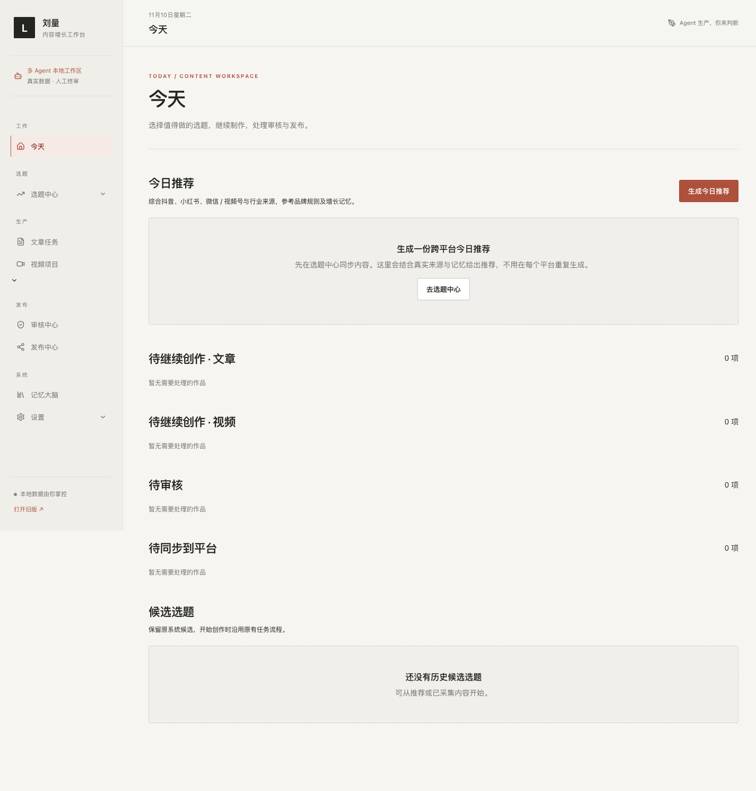

# 页面评审样板 01：今天

> 本文件是**单页评审样式样板**。评审顺序固定为：先核对页面用途和卡片顺序，再逐卡核对控件、限制和技术实现，最后检查页面状态与本页验收点。确认此样式后，其他页面也按同一结构逐页编写，不再使用跨页面大矩阵。

## 一、页面信息

| 项目 | 内容 |
|---|---|
| 一级页面 | 今天 |
| 页面入口 | 侧栏“今天”；路由 `/demo/` |
| 页面用途 | 选择值得做的选题，继续文章或视频制作，处理审核和平台发布准备 |
| 页面主要数据 | 跨平台推荐、原候选选题、文章／视频工作记录、审核项、发布目标、后台任务状态 |
| 外部依赖 | 生成今日推荐需要真实来源和已配置的文本模型；其他区域只读汇总本地记录 |
| 本页没有的操作 | 没有文本输入框；不直接编辑文章／视频；不直接批准审核；不直接公开发布 |
| 截图证据 | 隔离空工作区真实 Chrome，2026-11-10；截图只证明空状态，动态卡片行为另按当前源码核对 |

## 二、页面结构与评审顺序

| 顺序 | 二级卡片／工作区 | 用户在这里完成什么 |
|---|---|---|
| 1 | 今日推荐 | 生成并比较跨平台推荐，选择做视频或文章 |
| 2 | 待继续创作 · 文章 | 继续文章编辑、审核或发布准备 |
| 3 | 待继续创作 · 视频 | 继续视频制作或查看关联审核 |
| 4 | 待审核 | 打开仍需人工处理的视频审核 |
| 5 | 待同步到平台 | 继续平台字段、预填或结果核对 |
| 6 | 候选选题 | 从原系统候选继续创建视频项目 |

## 三、卡片详细说明

### 卡片 1：今日推荐

| 三级：卡片元素和功能 | 功能描述 | 输入、状态与限制 | 功能背后调用的技术方案 |
|---|---|---|---|
| “生成今日推荐”按钮 | 结合抖音、小红书、微信／视频号和行业来源，并参考品牌规则与增长记忆，生成跨平台推荐；完成后刷新页面 | 需要已有真实快照和可用文本模型；已有同类任务运行时按钮禁用，防止重复提交 | POST `/api/topics/recommend`，参数 `agent=all` → `wb_jobs` → `TopicExecutors.recommend` → 当前配置的 Kimi CLI／Codex CLI／模型 API；记忆由 `KnowledgeService` 提供 |
| 推荐标题条目（有推荐时显示） | 切换当前查看的推荐，右侧展示对应理由、来源和建议格式 | 只切换选择，不创建任务；可标记“建议文章／建议视频” | React 本地 `selected` 状态；推荐和证据来自 `TopicService.bootstrap` |
| 推荐理由与证据区 | 查看推荐角度、适用场景、引用来源及使用的增长记忆 | 没有证据时不能编造来源；待验证记忆不能写成成功规律 | 推荐的 `reason/angle/evidence_ids/memory_ids`；`KnowledgeService.memories` 只作为参考数据 |
| “制作视频”按钮 | 从当前推荐创建视频项目并进入项目页面 | 只创建任务，不自动生成文案或成片 | POST `/api/topics/candidates/:id/create-task` → 原 `tasks`；`source_json` 保存推荐和证据关联 |
| “打开视频任务”按钮（已转化时显示） | 打开该推荐已经创建的项目，避免重复创建 | 已转化但缺少任务 ID 时不能假装有有效链接 | 同上；按已有 `task_id` 跳转 `/tasks/:id` |
| “写文章／用这个选题写文章”按钮 | 创建文章，把推荐标题、理由、切入和来源带入写作要求 | 不自动生成大纲或正文；进入后仍需编辑和审核 | POST `/api/articles` → `wb_campaigns/wb_content_items`；推荐来源写入文章 brief |
| “改做视频”按钮（文章型推荐显示） | 把文章方向的推荐改为视频任务 | 与“写文章”是两条不同创建路径 | 候选 create-task → `tasks`，保留同一推荐依据 |
| 证据“原链接”（有来源时显示） | 新标签打开真实来源页面 | 链接可用性取决于网络、平台页面和登录状态 | 使用快照中的真实 `canonical_url`；浏览器外链，不经过模拟详情页 |
| “去选题中心”按钮（空状态显示） | 进入抖音选题页，先同步真实内容 | 仅导航，不触发同步或模型生成 | React Router Link → `/topics/douyin` |
| 生成失败错误区 | 显示模型或任务失败原因及处理建议，保留已有推荐 | 不把失败改成成功，不用空列表覆盖旧推荐 | `wb_jobs.error_json` + 前端 `ErrorBox`；旧推荐来自本地快照 |

### 卡片 2：待继续创作 · 文章

| 三级：卡片元素和功能 | 功能描述 | 输入、状态与限制 | 功能背后调用的技术方案 |
|---|---|---|---|
| 数量标识 | 显示当前仍需处理的文章数量 | 不包含已发布／已归档等终态记录；不是历史文章总数 | GET `/api/v2/work-overview` → `overview.py` 只读查询 `wb_content_items` 和 `wb_campaigns` |
| 文章工作条目（有记录时显示） | 显示文章标题、当前状态和下一步，点击进入编辑、审核或发布准备 | 每条最多展示当前组前 5 条；状态文案来自真实状态映射 | `overview.py` 按文章 `state` 生成 `/articles/:id` 或 `/publish?kind=article&id=...` |
| “查看全部”（超过 5 条时显示） | 进入完整文章列表 | 只导航，不修改文章状态 | React Router Link → `/articles` |
| “暂无需要处理的作品”（空状态） | 表示当前没有待继续处理的文章，不表示从未创建文章 | 空工作区截图已验证此状态 | 同一只读查询；不使用演示文章填充 |

### 卡片 3：待继续创作 · 视频

| 三级：卡片元素和功能 | 功能描述 | 输入、状态与限制 | 功能背后调用的技术方案 |
|---|---|---|---|
| 数量标识 | 显示尚未发布或完成复盘的视频项目数量 | 不是历史项目总数 | `overview.py` 只读查询 `tasks`，排除 `published/analyzed` |
| 视频工作条目（有记录时显示） | 继续映序制作；已交付时显示关联审核；内容变化时提示重新交付 | 最多显示前 5 条；不把交付过期项目当成可继续发布 | 读取 `tasks.source_json.yingxu_handoff`；链接到 `/tasks/:id` 或 `/review?batch_id=...` |
| “查看全部”（超过 5 条时显示） | 进入视频项目首页 | 原项目 ID 保持不变 | React Router Link → `/tasks`，当前渲染为视频项目首页 |
| “暂无需要处理的作品”（空状态） | 当前没有待继续制作的视频 | 空工作区截图已验证此状态 | 同上，不使用示例项目填充 |

### 卡片 4：待审核

| 三级：卡片元素和功能 | 功能描述 | 输入、状态与限制 | 功能背后调用的技术方案 |
|---|---|---|---|
| 数量标识 | 显示尚未人工通过的审核项数量 | 不等同机器预审问题数，也不等同全部视频数 | `overview.py` 查询 `review_items WHERE decision != approved` |
| 审核条目（有记录时显示） | 显示文件名、审核状态和下一步，打开对应审核批次 | 需要人工决定的项目保持待处理；最多显示前 5 条 | `review_items.batch_id` → `/review?batch_id=...`；状态由 `status/decision` 映射 |
| “查看全部”（超过 5 条时显示） | 进入审核中心 | 只导航，不批准或驳回 | React Router Link → `/review` |
| “暂无需要处理的作品”（空状态） | 当前没有待人工通过的审核项 | 空工作区截图已验证此状态 | 同一只读查询 |

### 卡片 5：待同步到平台

| 三级：卡片元素和功能 | 功能描述 | 输入、状态与限制 | 功能背后调用的技术方案 |
|---|---|---|---|
| 数量标识 | 显示仍未完成的平台发布目标数量 | 草稿、预填中、待确认、失败、待核实分别计数；不等于已公开发布数 | `overview.py` 联查 `publish_targets` 和 `publish_batches`，排除 `published/succeeded/cancelled` |
| 发布条目（有记录时显示） | 显示平台、来源和下一步，进入发布工作区 | 只继续字段、预填或结果核对；不直接公开 | 按 `content_kind/source_id/source_file_id` 生成发布链接；目标状态来自数据库 |
| “查看全部”（超过 5 条时显示） | 进入发布中心 | 只导航，不执行同步 | React Router Link → `/publish` |
| “暂无需要处理的作品”（空状态） | 当前没有待处理发布目标 | 空工作区截图已验证此状态 | 同一只读查询 |

### 卡片 6：候选选题

| 三级：卡片元素和功能 | 功能描述 | 输入、状态与限制 | 功能背后调用的技术方案 |
|---|---|---|---|
| 候选卡片（有候选时显示） | 显示原系统候选标题和切入方向 | 默认最多 5 条，候选保留原始记录 | `AppContext.core.topics`；数据来自现有候选接口 |
| “开始创作”按钮 | 从当前候选创建视频项目并进入项目 | 不直接生成完整内容；创建失败时保留候选 | POST `/api/tasks {topic_id}` → `tasks`；成功后按返回 `content_id` 导航 |
| “查看历史／收起历史”（超过 5 条时显示） | 展开全部候选或恢复前 5 条 | 只改变页面显示，不改变候选状态 | React 本地 `history` 布尔状态 |
| “还没有历史候选选题”（空状态） | 提示从推荐或已采集内容开始 | 空工作区截图已验证此状态；不用演示候选填充 | 当前候选接口返回空集合 |

## 四、本页状态与异常表现

| 页面状态 | 应该看到什么 | 技术来源与评审要点 |
|---|---|---|
| 首次加载 | 全局“正在读取真实数据…” | `AppContext` 同时加载 core、topics、agents、accounts、articles、knowledge；加载完成前不伪造卡片 |
| 空工作区 | 推荐、四类工作进度和候选均显示空状态 | 本样板截图已验证；不能显示示例项目 ID 或虚构指标 |
| 推荐生成中 | 按钮显示“正在生成今日推荐…”并禁用，后台继续执行 | `topics.recommend` 活动状态 + 每 3 秒刷新；离开页面任务仍保留 |
| 推荐生成失败 | 显示错误原因和处理建议，已有推荐仍保留 | `wb_jobs.error_json`；不得把旧推荐删除或改成新成功 |
| 工作记录超过 5 条 | 对应卡片出现“查看全部” | 首页只作摘要，完整列表在原模块 |
| 本地执行器停止 | 页面提示“本地制作服务未运行，请到接入与连接恢复服务；已有作品保留” | `work-overview.worker.running`；不能把排队任务显示为正在执行 |
| 工作进度读取失败 | 显示错误；有上次快照时保留上次内容 | `WorkOverview` 错误处理；不把读取失败当成全部工作为空 |

## 五、本页 review 检查清单

- [ ] 页面标题、用途和卡片顺序是否与截图一致。
- [ ] 没有真实快照时，是否仍明确提示先采集，而不是生成演示推荐。
- [ ] “生成今日推荐”是否只提交一次后台任务，失败是否保留旧推荐。
- [ ] 推荐做视频／写文章是否进入对应真实项目，并保留证据关联。
- [ ] 已转化推荐是否打开原任务，而不是重复创建。
- [ ] 四类工作进度是否来自对应真实记录，数量口径是否没有混算。
- [ ] 超过 5 条时是否出现“查看全部”，少于或等于 5 条时不显示多余按钮。
- [ ] 审核和发布状态是否只表示本地阶段，没有被写成已公开。
- [ ] 本地执行器停止时，是否提示恢复服务且保留已有作品。
- [ ] 空状态、加载中、生成中、失败和读取失败是否都能区分。

## 六、本页技术索引（只在需要修改时查看）

| 层级 | 当前实现 |
|---|---|
| 页面组件 | `webapp/src/pages/Today.tsx` |
| 工作进度组件 | `webapp/src/components/WorkOverview.tsx`，本页使用 `contentOnly` 模式 |
| 推荐卡片组件 | `Topics.tsx` 中的 `Recommendations`、`TopicCard` |
| 页面数据聚合 | `webapp/src/AppContext.tsx` |
| 工作进度接口 | GET `/api/v2/work-overview` → `content_workbench/overview.py`，只读投影，不建立第二套任务库 |
| 推荐任务接口 | POST `/api/topics/recommend` → `TopicExecutors.recommend` → `wb_jobs` |
| 视频创建接口 | `/api/tasks`、`/api/topics/candidates/:id/create-task` |
| 文章创建接口 | POST `/api/articles` → `Workbench` |
| 主要数据 | `tasks`、`wb_campaigns/wb_content_items`、`review_items`、`publish_targets/publish_batches`、`growth_memories` |

